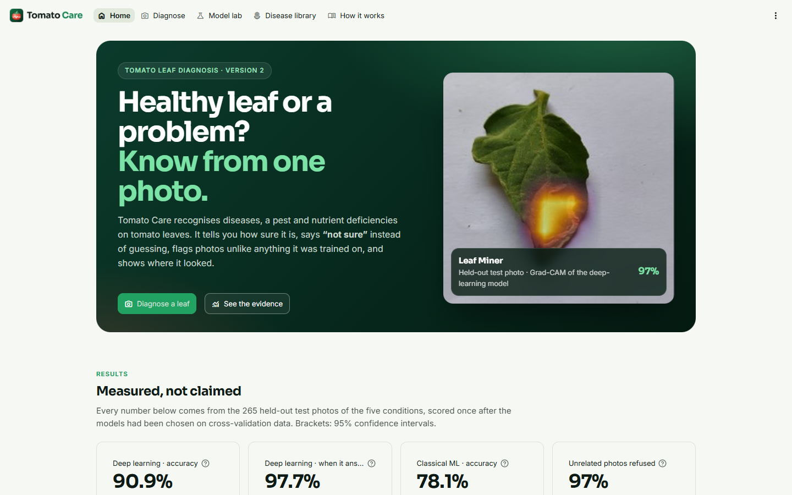
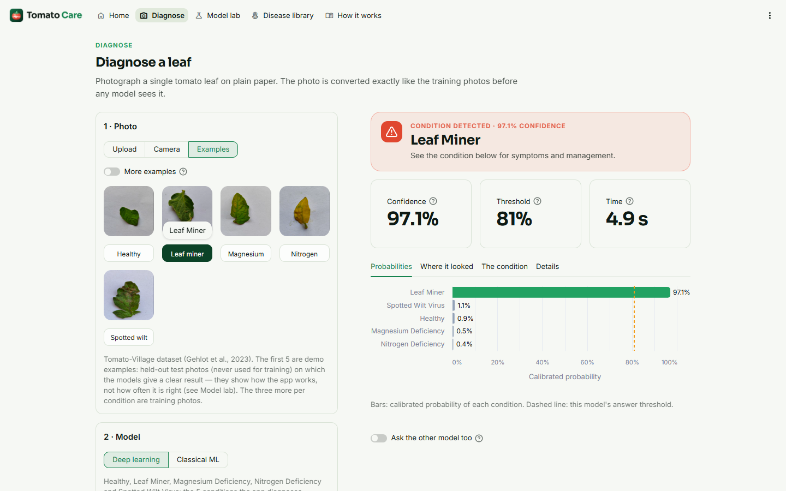
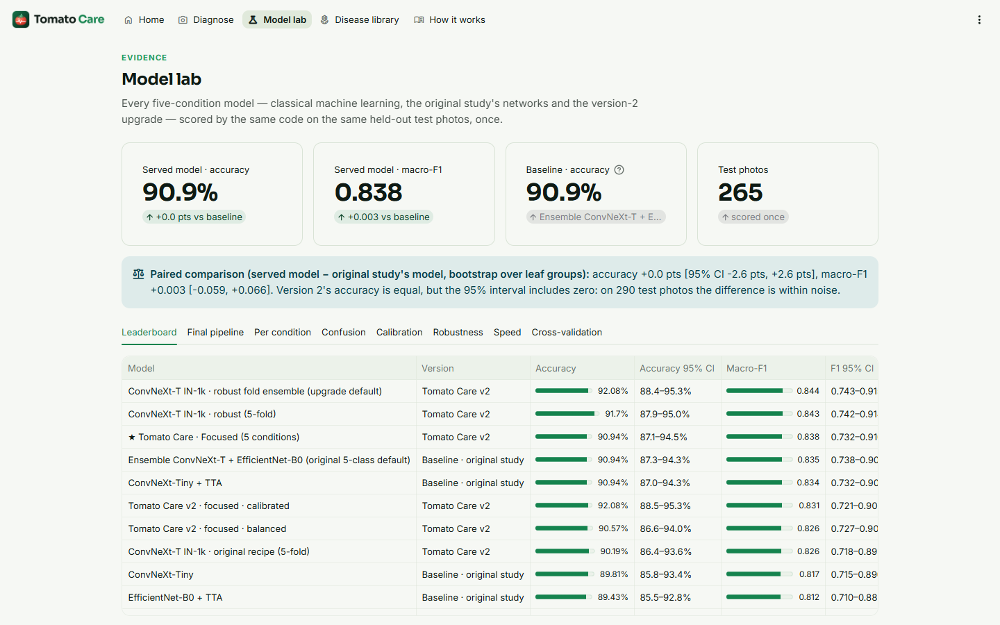
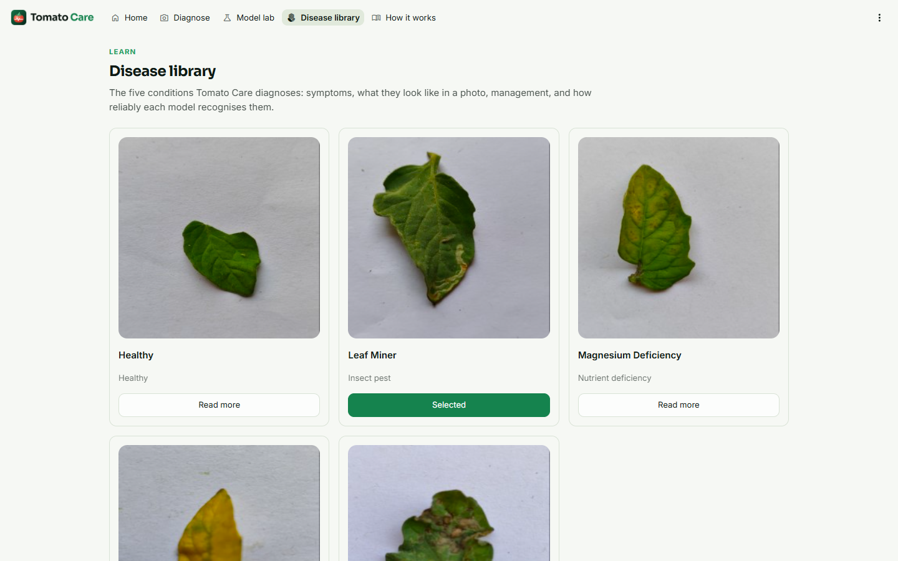
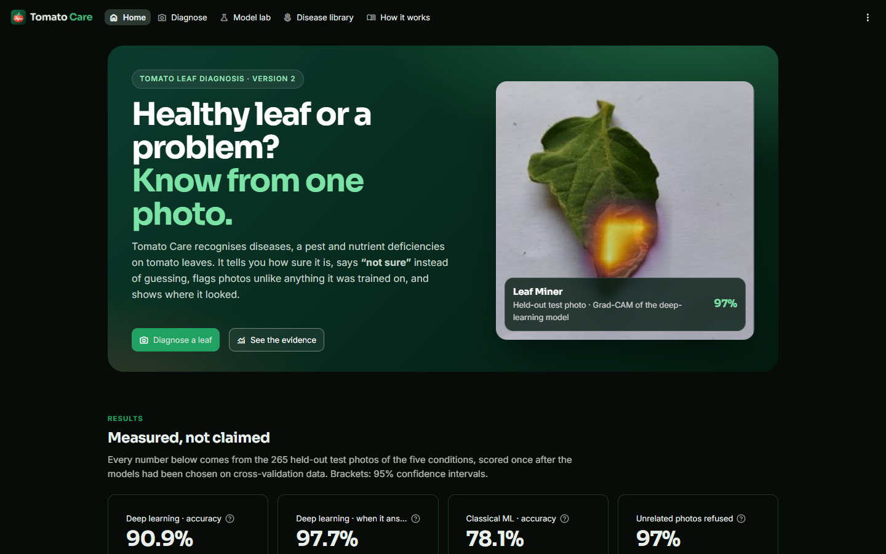
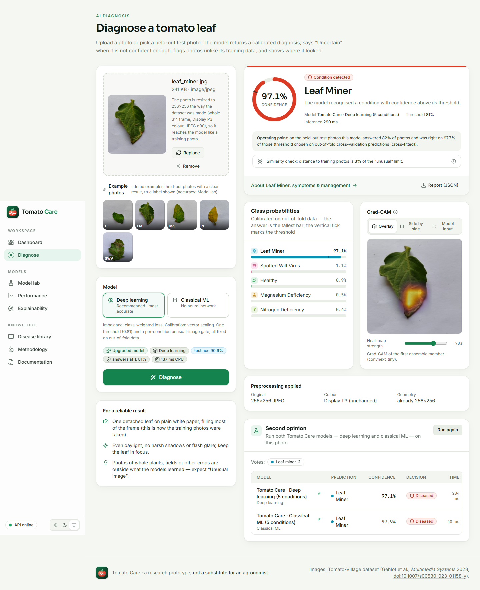
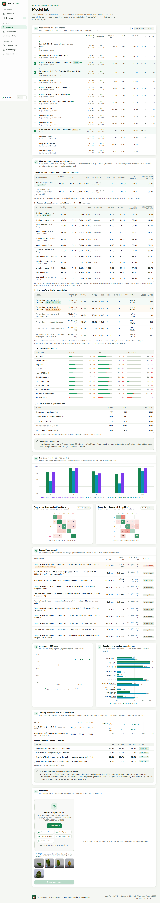

<div align="center">

<picture>
  <source media="(prefers-color-scheme: dark)" srcset="assets/brand/logo-dark.png">
  
</picture>

**Tomato leaf disease diagnosis from a single photo — with calibrated confidence, an honest “not sure”,
an unusual-image check and Grad-CAM explanations, evaluated without data leakage.**

[](https://github.com/CodewithBhaumik/Tomato-Care/actions/workflows/ci.yml)


**Live app: [tomato-care.streamlit.app](https://tomato-care.streamlit.app)**



</div>

## Contents

1. [What it does](#what-it-does)
2. [Results](#results)
3. [What changed in version 2](#what-changed-in-version-2)
4. [Run it](#run-it) · [Deploy on Streamlit Community Cloud](#deploy-on-streamlit-community-cloud)
5. [Tour](#tour)
6. [How it works](#how-it-works)
7. [Reproducing the experiments](#reproducing-the-experiments)
8. [Project structure](#project-structure)
9. [Limitations](#limitations)
10. [Dataset, citation and licence](#dataset-citation-and-licence)

## What it does

Photograph a single tomato leaf on plain paper. Tomato Care tells you whether it is healthy or which of four conditions
it shows — Leaf Miner, Magnesium Deficiency, Nitrogen Deficiency or Spotted Wilt Virus — and how sure it is:

| Answer | When |
|---|---|
| **Healthy / Condition detected** | calibrated confidence at or above the model's threshold |
| **Not sure** | confidence below the threshold — no diagnosis instead of a guess |
| **Unusual image** | the photo looks unlike every training photo (not a leaf on paper, another crop, …) |

Every answer comes with the probability of each condition, photo-quality tips, a Grad-CAM heat map (deep-learning
model), the symptoms and management of the condition, and — on request — the other model's answer on the same photo.
Two models diagnose the same five conditions:

* **ConvNeXt-Tiny ensemble** (deep learning, default) — 5 ConvNeXt-Tiny networks, class-weighted loss, trained to be unsure on the
  dataset's other three conditions (outlier exposure). Threshold 0.81. Test: accuracy
  90.9% (87.1%–94.5%), macro-F1 0.838; it answers 82% of photos, 97.7% of them correctly.
* **Gradient Boosting** (classical ML) — gradient boosting on handcrafted colour + texture features of the leaf (HSV histograms and L\*a\*b\* statistics,
  LBP and GLCM texture), no neural network. Threshold 0.84. Test: accuracy
  78.1% (72.1%–83.9%), macro-F1 0.634; it answers 59% of photos, 91.7% of them correctly.

Classical − deep learning on the same photos: -12.8 accuracy points (95% CI -18.9 to -7.2), macro-F1 -0.204 (-0.318 to -0.095). Both models were chosen on cross-validation data only, with the
same rules (calibration, threshold, unusual-image check), and scored once on the same 265 held-out test
photos ([docs/FINAL_REPORT.md](docs/FINAL_REPORT.md)). The example gallery shows demo examples: held-out test photos
chosen for a clear result (disclosed on the page); the numbers above and in the Model lab are what to quote.

**Why five conditions.** The dataset has eight. In the earlier eight-condition study, Early Blight (62 photographs),
Late Blight and Potassium Deficiency (9 photographs) were rarely recognised, so the app diagnoses the other five. Photos
of those three conditions are only used to check that they are refused: the deep-learning model refuses
52% of them, the classical model 28%.

Two front ends share one prediction engine (`backend/services/predictor.py`):

* **Streamlit app** (`streamlit_app.py`) — the online demo, built for Streamlit Community Cloud: diagnosis, model lab,
  disease library and methodology.
* **React platform + REST API** (`frontend/`, `backend/`) — the full web platform (dashboard, diagnosis studio, model
  lab, performance, explainability, library, methodology, docs) served by FastAPI, as one Docker container.

## Results

All models were scored by the same code on the same **265 held-out test photos** of the five conditions —
**once**, after every model choice had been fixed on cross-validation data. 95% confidence intervals come from 2,000
bootstrap resamples of whole leaf groups. Full tables: [docs/FINAL_REPORT.md](docs/FINAL_REPORT.md) and
[docs/RESULTS.md](docs/RESULTS.md).

| Model | Accuracy (95% CI) | Macro-F1 | Balanced acc. | ECE | Answers → correct | Unsupported photos refused |
|---|---:|---:|---:|---:|---:|---:|
| **Tomato Care · Deep learning (5 conditions)** | 90.9% (87.1%–94.5%) | 0.838 | 82.8% | 0.048 | 82% → 97.7% | 52% |
| **Tomato Care · Classical ML (5 conditions)** | 78.1% (72.1%–83.9%) | 0.634 | 61.3% | 0.074 | 59% → 91.7% | 28% |
| Tomato Care · Deep learning (5 conditions) (round 1) | 90.9% (87.1%–94.5%) | 0.838 | 82.8% | 0.048 | 46% → 99.2% | 100% |
| Ensemble ConvNeXt-T + EfficientNet-B0 (original 5-class default) | 90.9% (87.3%–94.3%) | 0.835 | 85.6% | 0.039 | 85% → 96.0% | 12% |

* **Deep learning vs classical ML.** -12.8 accuracy points (95% CI -18.9 to -7.2), macro-F1 -0.204 (-0.318 to -0.095). The network is clearly better; the classical model is the honest
  baseline: what colour and texture statistics alone can do with the same data and the same rules.
* **Both say “not sure”.** Each model answers only above its own threshold, chosen on out-of-fold data for at least
  90% accuracy on answered photos, counting answered photos of the three unsupported conditions as errors. The
  classical model cannot reach 90% while answering half of the photos, so it uses the most accurate threshold that
  still answers half (the fallback written into the rule before training).
* **Earlier versions** (last two rows) are the deep model before the final round and the original study's model.
* **95% accuracy on unseen leaves is not reached**; the leaky official split gives higher numbers that measure
  memorisation of augmented copies (see [Methodology §2](docs/METHODOLOGY.md#2-a-leakage-free-split)).

## What changed in version 2

| Area | Version 1 | Version 2 |
|---|---|---|
| **Upload preprocessing** | centre-crop to a square, colour profile ignored | reproduces how the dataset was made: whole 3:4 frame squashed to 256×256, colour into Display P3, JPEG q90 |
| **Model selection** | one 311-photo validation split (1 Potassium photo) | grouped 5-fold cross-validation on 1,813 photos, fixed-epoch training, pre-registered rule, test scored once |
| **Backbones and recipes** | ConvNeXt-Tiny / EfficientNet-B0 (ImageNet-1k) | + ImageNet-22k ConvNeXt-T, DINOv2 ViT-S/14 and a frozen ViT-B/14 compared in CV; robust recipe (all 8 dihedral views, aspect jitter, JPEG/blur, EMA) |
| **Deployed models** | single checkpoints | fold ensembles: every member has truly held-out data for its calibration and thresholds |
| **Uncertainty** | threshold chosen on 311 photos | temperature scaling + threshold on out-of-fold predictions + **unusual-image** detector (kNN / Mahalanobis feature distance) |
| **Bias and confidence** | class-weighted loss only | + per-class calibration (vector scaling) and a class-prior correction (logit adjustment), fitted on out-of-fold data: balanced accuracy and per-class calibration better than v1 |
| **Evaluation** | per-model scripts | one benchmark through the app's own predictor: CIs, paired bootstrap, calibration, robustness, same-leaf consistency, CPU latency |
| **Apps** | basic Streamlit demo, 6-page React site | redesigned **Streamlit app** (light/dark, phone layout) and a React platform with 10 pages; new brand |
| **Serving** | all weights in RAM | ONNX Runtime for the API (~1.6–2× faster on CPU); **low-memory mode** for small servers (shared network, memory-mapped float16 weights: 0.9 GB instead of 2.4 GB private RAM, identical outputs) |
| **Engineering** | 28 API tests | 66 tests (library, API, Streamlit pages, weights, low-memory parity), browser checks of both apps, ruff, CI, Docker, release-hosted weights with SHA-256 checks |

## Run it

### Streamlit app (what the online demo runs)

```bash
git clone https://github.com/CodewithBhaumik/Tomato-Care.git && cd Tomato-Care
python -m venv .venv && source .venv/bin/activate      # Windows: .venv\Scripts\activate
pip install -r requirements.txt                          # CPU-only PyTorch on Linux; regular wheels elsewhere
streamlit run streamlit_app.py                           # downloads the weights on first start (0.9 GB, SHA-256 checked)
```

### Docker: REST API + React platform in one container

```bash
docker build -t tomato-care .         # downloads the model weights from the GitHub release (SHA-256 checked)
docker run -p 8000:8000 tomato-care   # open http://localhost:8000  (API docs: /api/docs)
```

### Local API + React development

```bash
pip install torch==2.7.0 torchvision==0.22.0 --index-url https://download.pytorch.org/whl/cpu
pip install -r requirements-train.txt && pip install -e .
python scripts/download_weights.py                        # served model weights from the release (--all: + baselines)
uvicorn backend.main:app --port 8000                      # API + docs at http://127.0.0.1:8000/api/docs
cd frontend && npm ci && npm run dev                      # website at http://localhost:5173
```

`curl -F "file=@leaf.jpg" "http://127.0.0.1:8000/api/predict"` — full reference in [docs/API.md](docs/API.md).

| Variable | Default | Meaning |
|---|---|---|
| `TOMATO_RUNTIME` | `onnx` (API), `torch` (Streamlit) | CPU runtime: ONNX Runtime (exported and cached automatically) or PyTorch |
| `TOMATO_LOWMEM` | `0` (API), `1` (Streamlit) | share one network per architecture; weights stay memory-mapped (small servers) |
| `TOMATO_THREADS` | CPUs available | PyTorch CPU threads |
| `TOMATO_LAZY_MODELS` | `0` | API: `1` = load only the default model at startup |
| `TOMATO_DEVICE` | `cpu` | API: `cpu` or `cuda` |
| `TOMATO_DOWNLOAD_WEIGHTS` | `1` | Streamlit: `0` = never download weights (offline, tests) |

## Deploy on Streamlit Community Cloud

1. Sign in at [share.streamlit.io](https://share.streamlit.io) with the GitHub account that owns this repository.
2. **Create app → Deploy a public app from GitHub**: repository `CodewithBhaumik/Tomato-Care`, branch `main`,
   main file `streamlit_app.py`, and an app URL of your choice.
3. **Advanced settings → Python 3.12**, then **Deploy**.

`requirements.txt` installs CPU-only PyTorch; `.streamlit/config.toml` holds the light and dark themes. On first
start the app downloads the weights (0.9 GB, SHA-256 checked) from the
[`weights-v2` release](https://github.com/CodewithBhaumik/Tomato-Care/releases/tag/weights-v2), so the first visit
after a restart takes longer. It runs in low-memory mode (about 0.9 GB of private memory for the two version-2
models) to fit a small server.
`python scripts/30_streamlit_check.py --url https://<your-app>.streamlit.app --no-shots` checks a deployed app in a
real browser.

## Tour

| Streamlit — diagnosis | Streamlit — model lab |
|---|---|
|  |  |
| **Streamlit — disease library** | **Streamlit — dark mode and phone** |
|  |  |
| **React platform — diagnosis studio** | **React platform — model lab** |
|  |  |

## How it works

```
photo ─▶ validate (type, size, decodes) ─▶ EXIF orientation ─▶ colour into Display P3
      ─▶ aspect ratio clamped to 3:4…4:3 ─▶ whole frame resized to 256×256 ─▶ JPEG q90      (= how the dataset was made)
      ─▶ fold ensemble of fine-tuned ConvNeXt-Tiny networks
      ─▶ temperature scaling ─▶ "not sure" threshold ─▶ "unusual image" check (feature-space distance) ─▶ Grad-CAM
      ─▶ photo-quality check (blur, light, leaf size, several leaves, background) ─▶ reason + tips when no diagnosis
```

* **Photo-quality tips** (`tomatoleaf.quality`): limits come from the training photos. They flag 2% of genuine test
  photos and almost all damaged or outside-dataset photos. Every refusal says why ("only 42% sure", "unlike the
  training photos") and lists the top-3 candidates. The tips never change the diagnosis.

* **One predictor for everything**: the Streamlit app, the REST API and the offline benchmark call the same
  `ModelRegistry`, so the published numbers are the numbers the apps produce (CPU/GPU, ONNX/PyTorch and low-memory
  paths are checked to agree within 1e-6).
* **Models**: PyTorch; checkpoints store their architecture, input size, normalisation, and the feature statistics of
  their own training photos (for the unusual-image check).
* **Streamlit app**: multipage (`st.navigation`), brand theme for light and dark mode, Altair charts.
* **React platform**: React 19, Vite, Tailwind CSS 4, Recharts, Framer Motion; works read-only from a bundled results
  snapshot when the API is offline.

Details: [docs/METHODOLOGY.md](docs/METHODOLOGY.md) · model card: [docs/MODEL_CARD.md](docs/MODEL_CARD.md).

## Reproducing the experiments

The images are not redistributed (no licence). Download *Variant-a (Multiclass Classification)* of
[Tomato-Village](https://github.com/mamta-joshi-gehlot/Tomato-Village) into `Dataset/Variant-a(Multiclass Classification)/`,
install the GPU build of PyTorch and `requirements-train.txt`, then run the numbered scripts:

| Step | Scripts | Output |
|---|---|---|
| Data audit, leakage-free split | `01`–`04` | `data/index.csv`, `data/splits.csv`, EDA figures |
| Original study (classical ML and CNNs, 5-class scope) | `05`–`10`, `13` | `experiments/results/*.json` |
| Audit of the original models | `19_baseline_audit.py` | `baseline_audit.json` |
| Cross-validation folds and training | `20_make_cv_folds.py`, `21_train_cv.py`, `21b_frozen_features.py` | `experiments/cv/` |
| Model selection on out-of-fold data | `22_select_models.py` | `selection_*.json` |
| Deployment lists, CPU options | `23_build_deployment.py`, `24_cpu_inference.py` | `deployment.json` |
| Final test benchmark (once) | `25_final_benchmark.py` | `final_benchmark.json` |
| Release, app data, report, checks | `26`, `27`, `29`, `28_e2e_check.py`, `30_streamlit_check.py` | weights manifest, `platform.json`, `docs/RESULTS.md` |

Exact commands: [docs/METHODOLOGY.md §9](docs/METHODOLOGY.md#9-reproducing). Tests: `python -m pytest -q`
(66 tests; the ones that need weights or the dataset skip without them).

## Project structure

```
streamlit_app.py       Streamlit entry point (Community Cloud)      streamlit_ui/   its pages, charts, theme
backend/               FastAPI: api/ (routes), services/ (model registry, ONNX Runtime, data store), data/, tests/
frontend/              React platform + public/ (demo photos, Grad-CAM gallery, results snapshot, icons)
src/tomatoleaf/        library: preprocessing, models, training, evaluation, OOD, Grad-CAM, weights download
scripts/               numbered pipeline (01–13 original study, 19–30 upgrade) + brand assets, weights download
tests/                 library, Streamlit, weights and low-memory tests
data/                  derived metadata: index, leaf groups, split, CV folds — no images
experiments/           results JSON, CV summaries, deployment.json, platform.json, weights manifest
assets/brand/          logo and icon sources (scripts/make_brand_assets.py renders every size)
docs/                  methodology, results, model card, API, screenshots
```

## Limitations

* One phone model, two districts of Rajasthan, single leaves on paper: accuracy on field photos, other cameras or
  regions is unknown.
* Five conditions only: Early Blight, Late Blight and Potassium Deficiency are not diagnosed (too few photographs to
  learn them reliably). Nitrogen Deficiency has 45 photographs (8 in the test set): its per-class scores are very
  uncertain.
* The test set is small (265 photos): differences of a few points are within noise — read the intervals.
* The same test photos were used to report the original study, so they are not perfectly fresh; no upgrade decision
  used them.
* Unknown leaf conditions are hard to refuse: the deep model learned to refuse the dataset's other three conditions;
  diseases it has never seen may still get a diagnosis. The classical model had no such training.
* Grad-CAM shows where a network looked, not why a leaf is diseased; the classical model has no Grad-CAM.

## Dataset, citation and licence

Images: **Tomato-Village** — Gehlot, M., Saxena, R. K. & Gandhi, G. C. (2023). “Tomato-Village”: a dataset for
end-to-end tomato disease detection in a real-world environment. *Multimedia Systems*.
[doi:10.1007/s00530-023-01158-y](https://doi.org/10.1007/s00530-023-01158-y). The dataset has no declared licence:
it is not included here; the apps show 32 of its photos (demo and held-out test samples) with this citation.

Code: MIT licence (see [LICENSE](LICENSE)). Disease information summarises the extension sources cited in
`backend/data/disease_info.json`. Tomato Care is a research prototype — **not** a substitute for an agronomist or a
plant-health laboratory.
